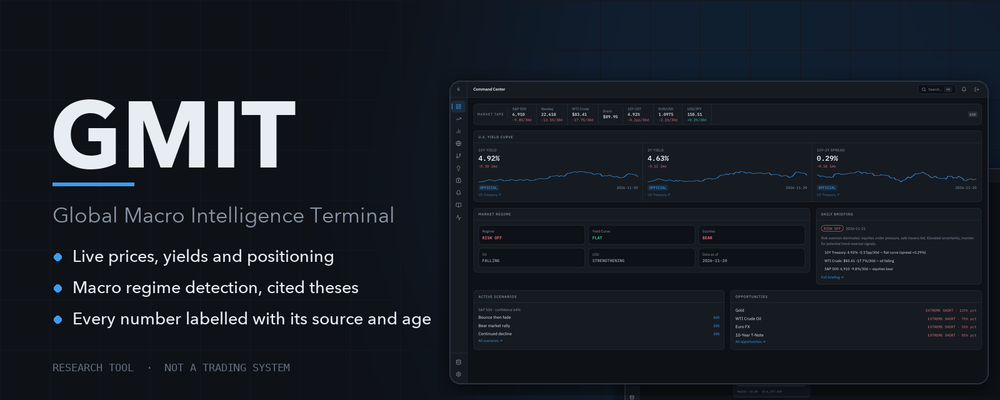
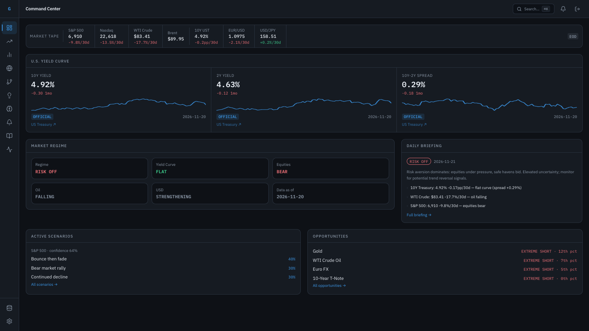
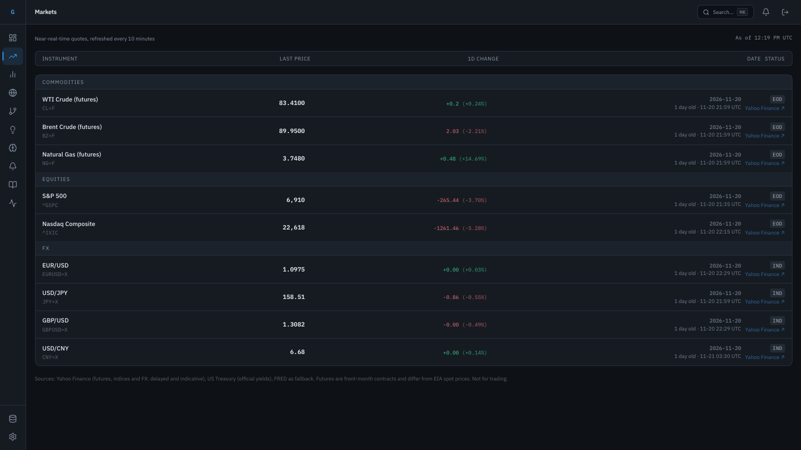
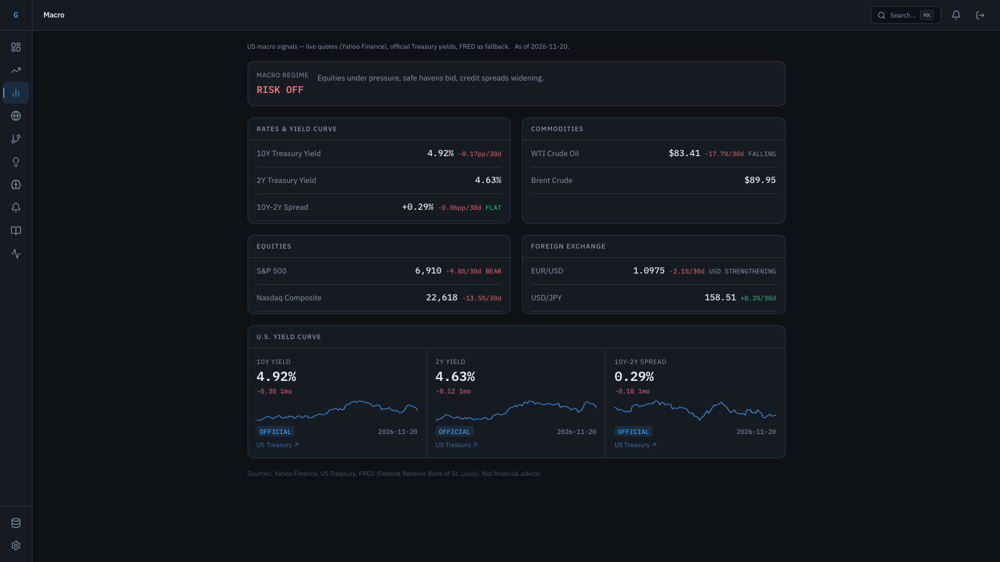
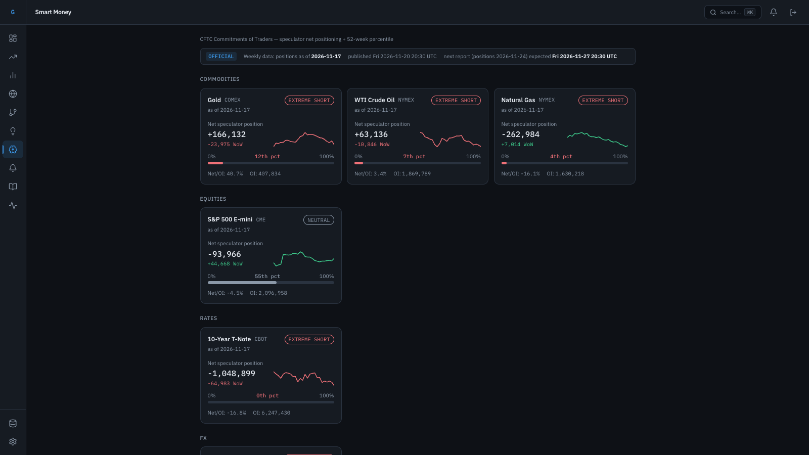
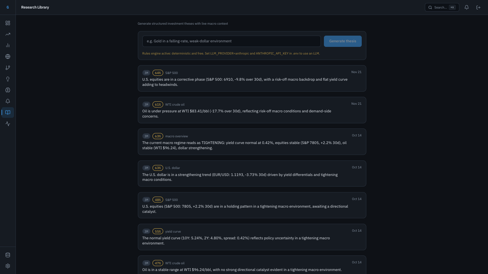
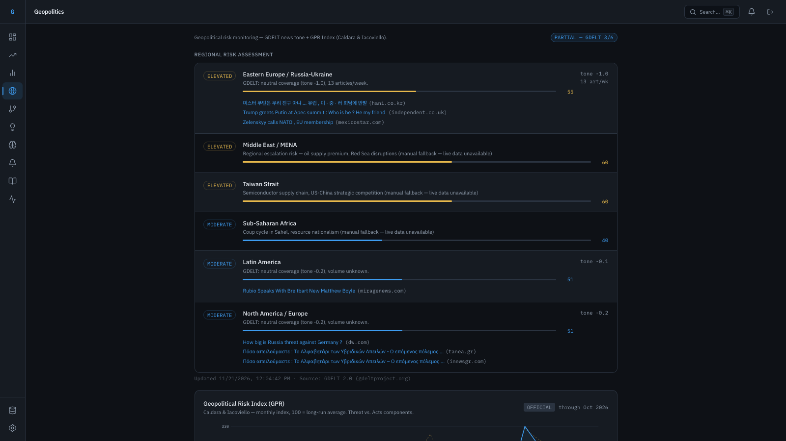
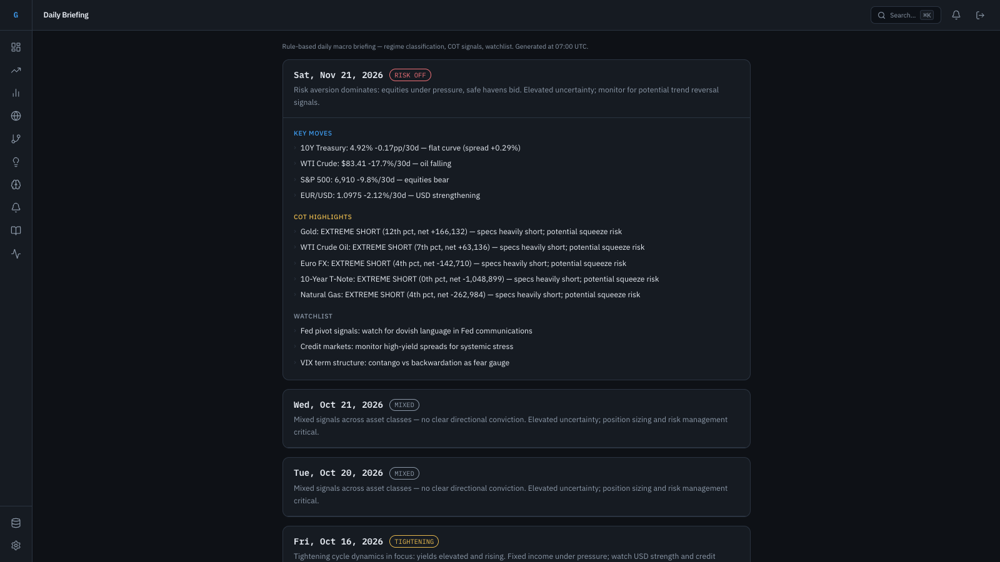
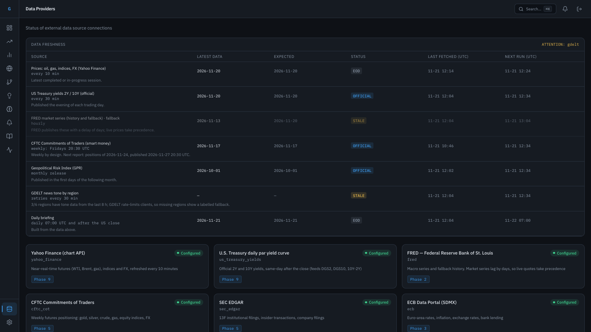
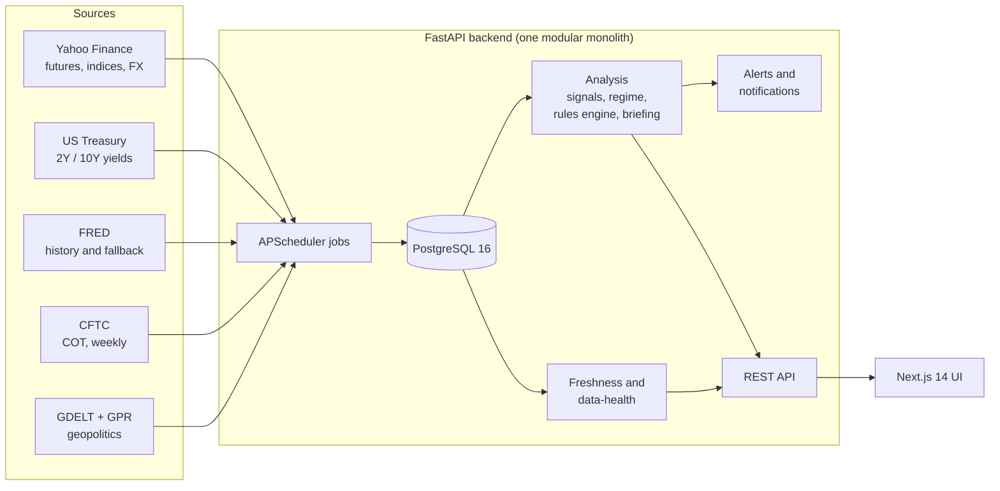

<p align="center">
  
</p>

<p align="center">
  
  
  
  
  
  
</p>

<p align="center">
  <b>A personal macro-financial research terminal.</b><br>
  It pulls live prices, official yields, futures positioning and geopolitical signals from public sources,
  classifies the macro regime, writes evidence-linked research theses and a daily briefing,
  and labels every number with where it came from and how old it is.
</p>

<p align="center"><i>A research tool, not a trading system: no order execution, no money movement.</i></p>

---

## Demo

<p align="center">
  <a href="https://github.com/Ax3Kpital/gmit/raw/main/docs/media/gmit-trailer.mp4">
    
  </a>
  <br>
  <sub>25-second walkthrough of every feature. <a href="https://github.com/Ax3Kpital/gmit/raw/main/docs/media/gmit-trailer.mp4">Open the full-quality MP4</a>.</sub>
</p>

## Contents

- [What it does](#what-it-does)
- [How it works](#how-it-works)
- [Where the data comes from](#where-the-data-comes-from)
- [Data freshness](#data-freshness)
- [How the analysis works](#how-the-analysis-works)
- [Install and run](#install-and-run)
- [Configuration](#configuration)
- [Tests and checks](#tests-and-checks)
- [Project structure](#project-structure)
- [Design principles and security](#design-principles-and-security)
- [Known limitations](#known-limitations)
- [Documentation](#documentation)

## What it does

<table>
  <tr>
    <td width="50%" valign="top">
      <b>Command Center</b><br>
      Market tape, US yield curve, the current macro regime, the latest briefing, active scenarios and positioning extremes on one screen.<br><br>
      
    </td>
    <td width="50%" valign="top">
      <b>Markets</b><br>
      WTI, Brent and natural gas futures, S&amp;P 500, Nasdaq and four FX pairs, refreshed every 10 minutes, each with its age, source and freshness label.<br><br>
      
    </td>
  </tr>
  <tr>
    <td valign="top">
      <b>Macro</b><br>
      Derived signals (curve shape, oil, equity and dollar trends) and an automatic regime: <code>risk_on</code>, <code>risk_off</code>, <code>stagflation</code>, <code>goldilocks</code>, <code>tightening</code>, <code>easing</code> or <code>mixed</code>.<br><br>
      
    </td>
    <td valign="top">
      <b>Smart Money</b><br>
      CFTC Commitments of Traders for six instruments: net speculator positioning, a 52-week percentile and extreme-positioning flags, with the weekly release calendar.<br><br>
      
    </td>
  </tr>
  <tr>
    <td valign="top">
      <b>Research Library and Scenarios</b><br>
      Structured theses with a claim, confidence, time horizon, catalysts, invalidation triggers, probability-weighted scenarios, counter-arguments and linked evidence.<br><br>
      
    </td>
    <td valign="top">
      <b>Geopolitics</b><br>
      Regional risk from news tone and volume (GDELT) next to the long-run Geopolitical Risk Index (Caldara and Iacoviello).<br><br>
      
    </td>
  </tr>
  <tr>
    <td valign="top">
      <b>Daily Briefing</b><br>
      A rule-based morning note: regime, key moves, COT highlights and a watchlist. Regenerated after the US close.<br><br>
      
    </td>
    <td valign="top">
      <b>Data Providers and freshness</b><br>
      For every source: the latest data date, the date expected right now, a freshness status, the last fetch and the next scheduled run.<br><br>
      
    </td>
  </tr>
</table>

Also included: **Opportunities** (regime signals, positioning extremes and recent theses together), **Alerts** (price-threshold and COT-extreme rules, with optional email and Telegram delivery) and **Agent Activity** (a log of every automated run).

## How it works



1. **Ingestion.** Scheduled jobs fetch each source, normalise it and store every observation together with its provider, source URL, observation date, retrieval time, units and freshness status.
2. **Analysis.** Deterministic Python turns stored series into signals (30-day changes, curve shape, trends), a macro regime, theses, a daily briefing and alerts. Calculations are tested code; nothing is estimated by a model.
3. **Freshness.** A status is computed from the date of the newest observation, never from when it was downloaded, so old data can never look current.
4. **Serving.** FastAPI exposes everything behind session authentication; Next.js renders the pages and refreshes them every 60 seconds.

| Job | Cadence |
|---|---|
| Live quotes (Yahoo Finance) | every 10 minutes |
| US Treasury yields | every 30 minutes |
| FRED history | hourly |
| COT check (fetches when a new CFTC report is due) | every 30 minutes |
| Geopolitics (GDELT for regions that lack recent data; GPR monthly file) | every 30 minutes |
| Alert rules | every 30 minutes |
| Daily briefing | 07:00 UTC, on startup, and 22:45 UTC on weekdays |

## Where the data comes from

| Source | What GMIT takes from it | Cadence | Access and terms |
|---|---|---|---|
| **Yahoo Finance** chart API | WTI, Brent and natural gas front-month futures; S&amp;P 500 and Nasdaq Composite; EUR/USD, USD/JPY, GBP/USD, USD/CNY | refreshed every 10 min; delayed or indicative quotes | No key. Unofficial endpoint, redistribution terms **unverified**: personal, non-commercial use only. S&amp;P 500 and Nasdaq closes matched FRED exactly on every overlapping date when cross-checked. |
| **US Treasury** daily par yield curve | 2-year and 10-year yields; the 10Y-2Y spread is computed locally | published the evening of each trading day | No key. US government data, public domain. |
| **FRED** (St. Louis Fed) | Macro history and a fallback for market series | FRED republishes oil, FX and index data with a delay of days | Free API key (optional but recommended). Attribution required. |
| **CFTC** Commitments of Traders (Legacy, futures only) | Net speculator positioning for gold, WTI, natural gas, S&amp;P 500 E-mini, 10-year T-Note, Euro FX | **weekly**: positions as of Tuesday, published Friday about 15:30 ET | No key. Public domain. |
| **GDELT** 2.0 | Regional news tone, volume and top articles for six regions | polled every 30 min; rate-limited by GDELT | No key. Free. |
| **GPR index** (Caldara and Iacoviello) | Monthly Geopolitical Risk Index with threat and acts components | monthly | Free for research; citation required. |

Three details worth knowing:

- **Futures are not spot.** WTI and Brent come from front-month futures, which differ from the EIA spot prices FRED publishes (WTI futures sat about 2.5 to 3 USD below spot when checked). They are stored as separate series and never spliced into the FRED ones.
- **COT cannot be daily.** CFTC releases once a week. GMIT polls every 30 minutes and fetches as soon as a new report is due, and the Smart Money page shows the report date, the publication time and the next expected release.
- **Fallbacks are labelled.** If a provider is down the value ages to `DELAYED` and then `STALE`. When GDELT cannot be reached, a region shows a static manual assessment clearly marked `UNAVAILABLE`.

Terms, rate limits and verification status for every provider are tracked in [`docs/DATA_SOURCE_REGISTER.md`](docs/DATA_SOURCE_REGISTER.md). SEC EDGAR, ECB, EIA and BLS appear in the provider registry as planned sources; no adapters exist for them yet.

## Data freshness

Every value carries one of these labels, computed from the date of its newest observation:

| Label | Meaning |
|---|---|
| `REALTIME` | Provider guarantees sub-second freshness |
| `DELAYED` | Quote is delayed, or the series is one session behind |
| `END_OF_DAY` | Completed daily close |
| `PERIODIC_OFFICIAL_RELEASE` | Scheduled government or central-bank release, current |
| `INDICATIVE` | Reference price, not executable |
| `STALE` | Two or more sessions behind (or a missed release) |
| `UNAVAILABLE` | Provider unreachable or no data |

The **Data Providers** page (and `GET /api/data-health`) compares each source's latest data with the date that should exist right now. FRED is shown as a fallback and is excluded from the overall health verdict because it lags by design. Rationale: [ADR-004](docs/ADR/ADR-004-live-market-data-and-freshness.md).

## How the analysis works

- **Signals and regime.** Thirty-day changes, curve shape (`inverted`, `flat`, `normal`, `steep`) and oil, equity and dollar trends feed a rule-based classifier that outputs the macro regime.
- **Theses.** A deterministic rules engine detects the topic (gold, oil, rates, equities, dollar, macro), reads the live signals, and fills structured templates with the real numbers: claim, confidence, catalysts, invalidations, scenarios, counter-arguments and linked evidence. It is **not** an LLM, so the same data produces the same thesis, at zero cost.
- **Optional LLM provider.** An Anthropic provider exists behind the same interface (`LLM_PROVIDER=anthropic`) but is not enabled by default and has not been exercised against the live API.
- **Briefing and alerts.** Rule-based, built from the same signals and COT data.
- **Recency.** Theses older than three days are hidden from Opportunities and flagged as outdated, because they were written on old data.

## Install and run

### Requirements

- [Docker Desktop](https://www.docker.com/products/docker-desktop/) (or Docker Engine with the Compose plugin)
- Free local ports **3001** (web), **8001** (API) and **5433** (PostgreSQL)
- Optional: a free [FRED API key](https://fred.stlouisfed.org/docs/api/api_key.html)

### Quick start

```bash
git clone https://github.com/Ax3Kpital/gmit.git
cd gmit
cp .env.example .env          # optionally paste your FRED_API_KEY into .env
docker compose up --build
```

The first build takes a few minutes. Then open:

| | |
|---|---|
| Web UI | http://localhost:3001 |
| API and interactive docs | http://localhost:8001/docs |

Sign in with the development account created automatically on first start: **`admin@gmit.local`** / **`gmit_dev_2026`**. It is for local use only: change it and set a real `SECRET_KEY` before exposing the app anywhere.

On startup the backend applies the database migrations, seeds the reference data and starts the scheduler, so prices and positioning begin filling in immediately. The geopolitics page may take a minute or two to populate (GDELT is deliberately slow to respect its rate limit). The app works without any API key: prices, Treasury yields, COT and GDELT need none, and only the FRED history needs one.

### Useful commands

```bash
make up                 # docker compose up --build
make down               # stop
make logs               # follow logs
make migrate            # alembic upgrade head
make shell-db           # psql into the database
docker compose exec backend pytest        # backend tests
docker compose exec web npx tsc --noEmit  # frontend type check
```

### Run without Docker (development)

```bash
# PostgreSQL 16 must be running; point DATABASE_URL at it in .env
cd backend
pip install -r requirements.txt
alembic upgrade head
python scripts/seed_dev.py
uvicorn app.main:app --reload --port 8001

# in another terminal
cd apps/web
npm install
API_URL=http://localhost:8001 npm run dev
```

### Notifications (optional)

- **Telegram:** create a bot with `@BotFather`, copy the token, message the bot once, read your chat id from `https://api.telegram.org/bot<TOKEN>/getUpdates`, put both in `.env` and restart the backend.
- **Email:** set the `SMTP_*` variables and `NOTIFICATION_EMAIL` (Gmail, SendGrid, Resend and Mailgun all work with SMTP credentials).

The Settings page shows whether each channel is configured. Delivery of alerts and the daily briefing is implemented but has not been exercised against a live channel.

### Production deployment

`docker-compose.prod.yml`, a Caddy reverse proxy (automatic HTTPS) and `deploy.sh` are included for a single VPS. Set `DOMAIN`, strong database credentials and `SECRET_KEY` in `.env` first. This path has not been tested on a real server yet.

## Configuration

All settings are environment variables; see [`.env.example`](.env.example) for the full list.

| Variable | Purpose |
|---|---|
| `FRED_API_KEY` | FRED history and fallback. Free. Optional. |
| `LLM_PROVIDER` | `rules` (default, deterministic, free), `mock`, `anthropic` or `openai` |
| `ANTHROPIC_API_KEY`, `OPENAI_API_KEY` | Only for the matching LLM provider |
| `SMTP_*`, `NOTIFICATION_EMAIL` | Email notifications |
| `TELEGRAM_BOT_TOKEN`, `TELEGRAM_CHAT_ID` | Telegram notifications |
| `SECRET_KEY`, `DATABASE_URL`, `CORS_ORIGINS`, `APP_ENV` | Core application settings |

Secrets live only in `.env`, which is gitignored. HTTP request logging is kept off at INFO level because some providers take API keys in the query string.

## Tests and checks

```bash
docker compose exec backend pytest
docker compose exec web npx tsc --noEmit
```

The backend suite (130+ tests) covers macro signals and regime classification, geopolitical risk scoring, freshness classification, the COT release calendar, provider parsing for Yahoo, Treasury, GDELT and GPR, rate-limit handling, provider-failure behaviour, secret-free logging and the data-health report. Database tests run against a throwaway `gmit_test` database on the same Postgres, never your data. The tests need no network access.

## Project structure

```
gmit/
├── apps/web/                 Next.js 14 UI (TypeScript, Tailwind)
│   ├── app/                  one folder per page
│   ├── components/           layout, market, macro, smart-money, geo, research
│   └── messages/en.json      UI text (English only)
├── backend/
│   ├── app/
│   │   ├── api/routes/       REST endpoints
│   │   ├── analysis/         signals, regime, rules engine, briefing, geo scoring
│   │   ├── providers/        Yahoo, Treasury, FRED, CFTC, GDELT, GPR adapters
│   │   ├── services/         ingestion jobs, freshness report, alerts, notifications
│   │   ├── core/             settings and freshness rules
│   │   ├── db/               SQLAlchemy models
│   │   └── llm/              rules engine provider and optional LLM provider
│   ├── alembic/              database migrations
│   └── tests/
├── docs/                     implementation plan, data source register, ADRs, domain model
├── docker-compose.yml        local stack: Postgres, API, web
├── docker-compose.prod.yml   single-VPS deployment with Caddy
└── Makefile
```

## Design principles and security

- **Never fabricate data.** Unavailable means `UNAVAILABLE` or `STALE`, never an invented value.
- **Provenance on every observation:** provider, source URL, observation date, retrieval time, units and status.
- **Deterministic finance.** Calculations are tested code; any AI interprets, it does not compute.
- **No trade execution,** ever.
- Argon2id password hashing, `HttpOnly` session cookies, authenticated API, secrets kept out of git and out of logs.

The full rules live in [`CLAUDE.md`](CLAUDE.md).

## Known limitations

- **GDELT rate-limits clients** and sometimes blocks for a while. Regions without fresh data show a labelled fallback, and the job retries every 30 minutes.
- **Yahoo Finance is an unofficial endpoint** with unverified redistribution terms. Use it for personal research; swap in a licensed feed before any shared deployment (the provider sits behind a catalogue, so consumers do not change).
- **Theses come from a rules engine,** not a language model. The optional LLM provider is untested against the live API.
- **Email and Telegram delivery, and the production deployment path, have not been exercised end to end.**
- **No frontend tests** yet (type checking only). Some linting debt remains in older backend modules.
- Market holidays are not modelled: the first session after a holiday can briefly show as `DELAYED`.

## Documentation

- [`docs/IMPLEMENTATION_PLAN.md`](docs/IMPLEMENTATION_PLAN.md): phases and acceptance criteria
- [`docs/DATA_SOURCE_REGISTER.md`](docs/DATA_SOURCE_REGISTER.md): providers, terms, rate limits, verification status
- [`docs/DOMAIN_MODEL.md`](docs/DOMAIN_MODEL.md): entities and relationships
- [`docs/ADR/`](docs/ADR/): architecture decision records
- [`CLAUDE.md`](CLAUDE.md): project rules, design tokens and conventions

---

<p align="center"><sub>Private research tool. Not financial advice.</sub></p>
